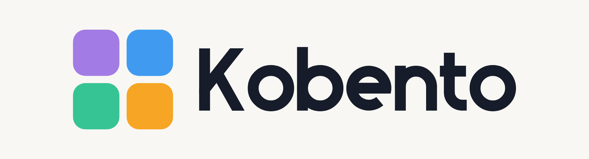
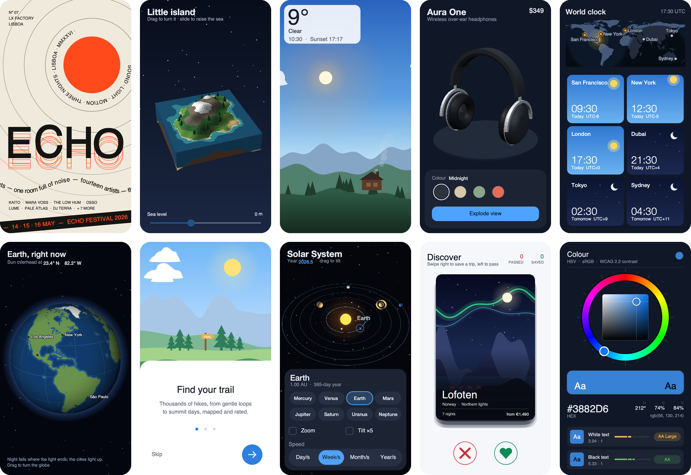
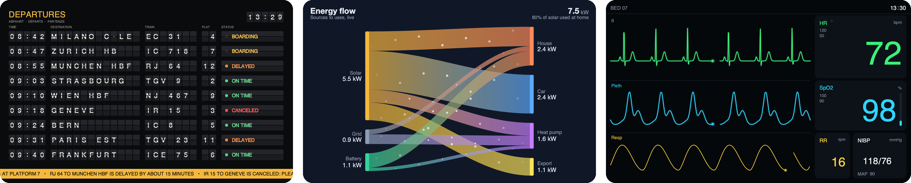
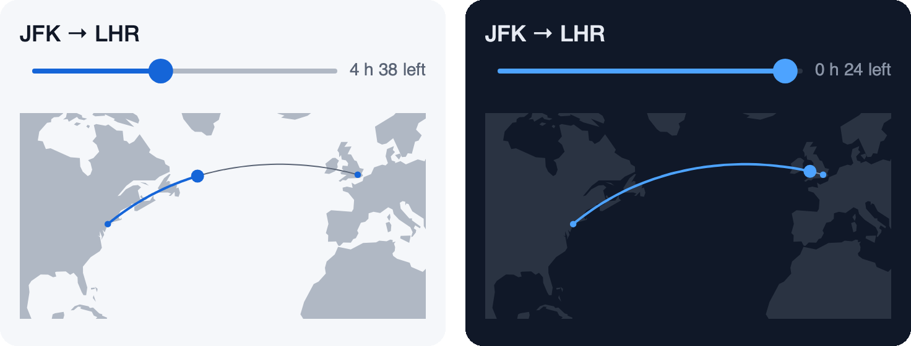
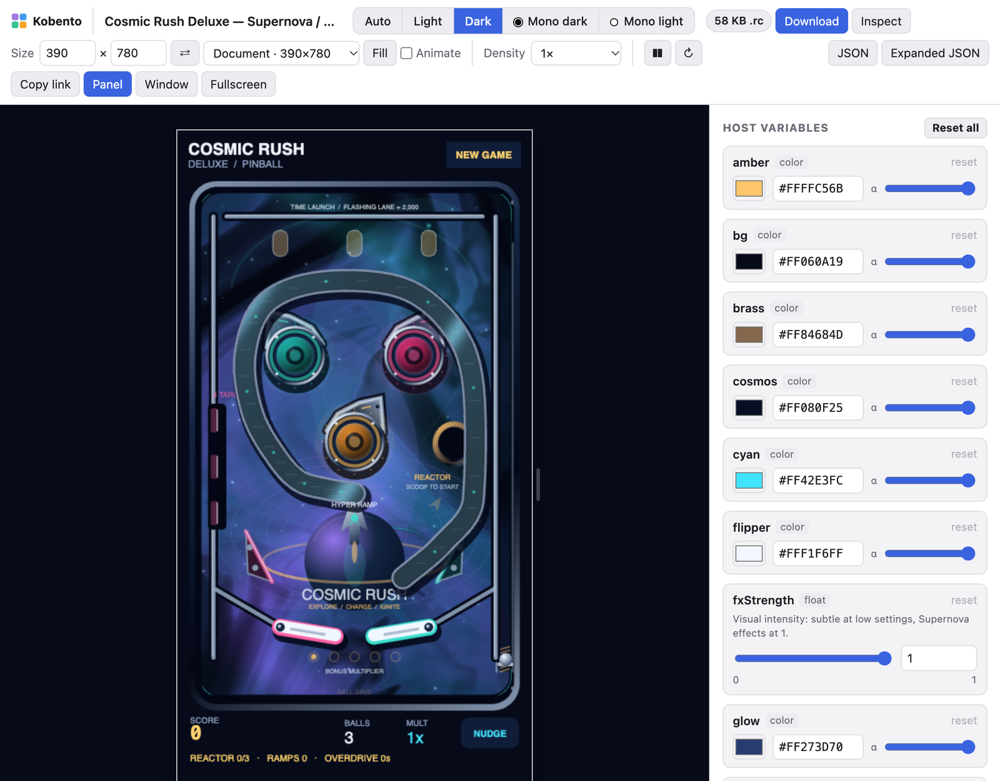
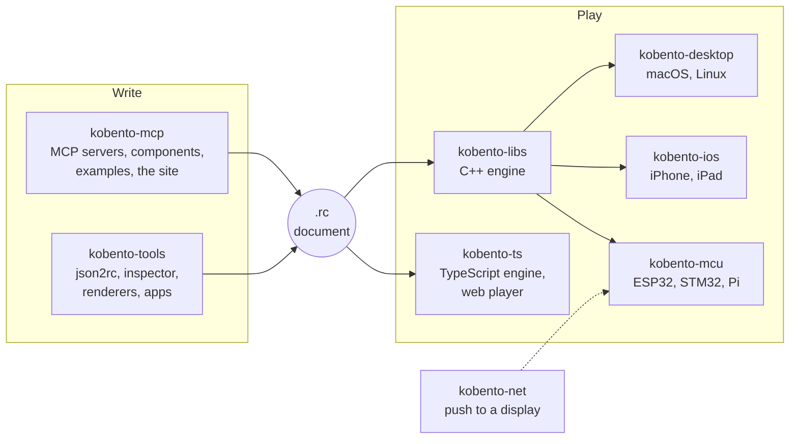

<p align="center">
  <a href="https://mcp.kobento.dev/">
    <picture>
      <source media="(prefers-color-scheme: dark)" srcset="https://raw.githubusercontent.com/kobento/.github/main/profile/images/banner-dark.png">
      
    </picture>
  </a>
</p>

<h3 align="center">Ask for a screen. Ship it to any device.</h3>

<p align="center">
  <a href="https://mcp.kobento.dev/"><b>Website</b></a> ·
  <a href="https://mcp.kobento.dev/showcases/">Showcases</a> ·
  <a href="https://mcp.kobento.dev/stream/">Stream</a> ·
  <a href="https://mcp.kobento.dev/tools/">MCP tools</a> ·
  <a href="https://mcp.kobento.dev/about/">How it fits together</a> ·
  <a href="https://mcp.kobento.dev/status/">Status</a>
</p>

---

**Kobento** is an open-source implementation of **RemoteCompose**, Android's format for
server-driven UI. A server sends a small binary document (`.rc`, usually a few kilobytes) and
the device draws it: layout, text, animation, touch, light and dark themes, even 3D. The screen
changes without an app update.

Kobento gives you everything around that format:

- 🧩 **Components.** About 90 of them, from buttons and sliders to charts, clocks, maps and 3D,
  each in light, dark and two monochrome looks (always-on and e-ink).
- 🤖 **AI tools.** An MCP server that lets Claude, ChatGPT, Gemini or any assistant find the
  right parts, write the document, render it, check it and publish it.
- ▶️ **Players.** Engines in C++ and TypeScript that draw the same document on the web, the
  desktop, iOS and microcontrollers. On Android, Google's own player plays it.
- 📡 **Delivery.** Published pages, a stream of what people make, and a small protocol to push
  documents to a display on your network.

> Kobento follows Android's RemoteCompose spec but is an independent project. It is **not
> affiliated with, endorsed or supported by Google**.

## What it can do

<p align="center">
  <a href="https://mcp.kobento.dev/showcases/">
    
  </a>
</p>

Every one of these is a single RemoteCompose document. They are 3D scenes, physics toys and live
data driven by the clock, all in a few kilobytes, and they adapt from a phone to a tablet.
[Play with them](https://mcp.kobento.dev/showcases/).

<p align="center">
  
</p>

They aren't just phone screens: departure boards, dashboards, wall displays and instruments are
documents too.

## Ask, then ship

Connect Kobento to your assistant and describe the screen you want:

> *A flight tracker card: New York to London on a map, the plane along the route at the
> flight's progress, the time left, and a slider to scrub through the flight.*

<p align="center">
  
</p>

The assistant picks the components, writes the document, renders it and checks it. It also
tries every control and audits for what Android's player would reject. Then it publishes the
result as a page, or hands you the `.rc`. This whole card is 15 KB, and it follows the system
theme and lays out again at any size. [Play with it](https://mcp.kobento.dev/play/example/).

```sh
# Claude Code
claude mcp add --transport http kobento https://mcp.kobento.dev/mcp
# Gemini CLI
gemini mcp add --transport http kobento https://mcp.kobento.dev/mcp
```

In claude.ai or ChatGPT, add a custom connector with the URL `https://mcp.kobento.dev/mcp`.
Accounts are free. [Every tool](https://mcp.kobento.dev/tools/).

## Play it, inspect it, share it

<p align="center">
  
</p>

Every published document gets a playground. You can resize it, switch the theme, set the values
the app would send, and open it in the inspector to see every operation, variable and byte. The
best ones go to the [stream](https://mcp.kobento.dev/stream/), where anyone can play them or
press **Remix** and have their assistant build their own version.

## The repositories



| Repository | What's in it |
| :--- | :--- |
| [**kobento-mcp**](https://github.com/kobento/kobento-mcp) | The MCP servers your assistant talks to, the component library, the example catalog, and the [website](https://mcp.kobento.dev/). |
| [**kobento-libs**](https://github.com/kobento/kobento-libs) | The C++ engine: it parses, lays out and runs a document, and paints through Skia, Core Graphics or ThorVG. Includes 3D. |
| [**kobento-ts**](https://github.com/kobento/kobento-ts) | The TypeScript engine and the web player that every published page embeds. |
| [**kobento-tools**](https://github.com/kobento/kobento-tools) | `json2rc` (JSON to `.rc`, byte for byte as Android's parser writes it), the inspector, the renderers, Lottie and vector-drawable converters, conformance tests, and the Android and iOS showcase apps. |
| [**kobento-desktop**](https://github.com/kobento/kobento-desktop) | `rcviewer`, the desktop player for macOS and Linux. |
| [**kobento-ios**](https://github.com/kobento/kobento-ios) | The engine built for iPhone and iPad (Skia on Metal, or Core Graphics without Skia) and a viewer. |
| [**kobento-mcu**](https://github.com/kobento/kobento-mcu) | The microcontroller player: M5Stack Tab5, Core2 and PaperS3, Waveshare round LCD and AMOLED, Elecrow CrowPanels, with touch, knobs, buttons and e-paper. Also STM32U5 and Raspberry Pi. |
| [**kobento-net**](https://github.com/kobento/kobento-net) | Delivery over the local network: a tiny HTTP and mDNS protocol, with clients in Python, TypeScript and C++ and a reference receiver. |

## Write it by hand

A document is JSON. This one converts to 181 bytes:

```json
{
 "header": {"apiLevel": 7, "width": 300, "height": 120, "profiles": 513},
 "root": {
  "type": "box",
  "modifiers": ["fillMaxSize", {"background": "#FF101828"}],
  "horizontalAlignment": "center", "verticalAlignment": "center",
  "children": [{"text": {"value": "Good morning", "fontSize": 40, "color": "#FF4DA3FF"}}]
 }
}
```

```sh
git clone https://github.com/kobento/kobento-tools
node kobento-tools/json2rc/build/cli.js screen.json screen.rc   # Node.js only, no install step
```

Every example on [the site](https://mcp.kobento.dev/demos/) shows its JSON, and the
[component guide](https://github.com/kobento/kobento-mcp/blob/main/docs/COMPONENT_AUTHORING.md)
explains how to write your own components, or a whole new look for the library.

## Status

Kobento is **pre-1.0 and experimental**. What's measured against Android's reference:

- **C++ engine:** all 80 reference sample documents, and 59 advanced ones, parse with no field
  different from Android's own reader. Its 3D is bit-exact with the androidx reference renderer.
- **json2rc:** byte-identical on its whole 345-document test corpus.
- **TypeScript engine:** knows 162 of Android's 163 operations.

The [status page](https://mcp.kobento.dev/status/) has the details and the known gaps.

---

<p align="center">
  Open source under the Apache 2.0 license ·
  <a href="https://mcp.kobento.dev/">mcp.kobento.dev</a>
</p>
